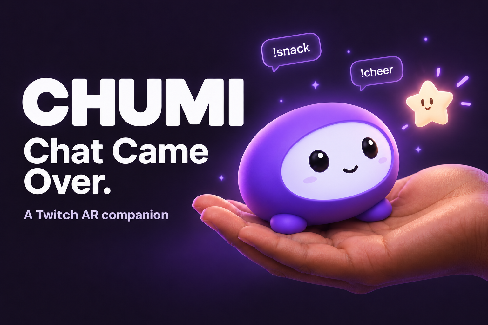
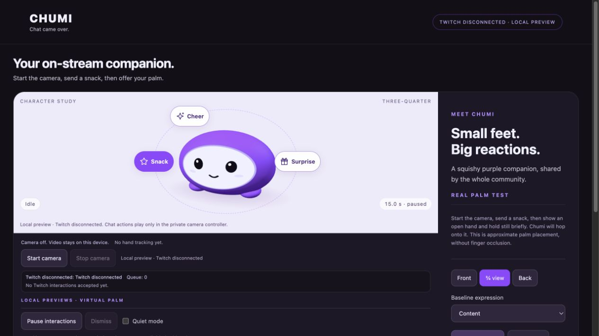
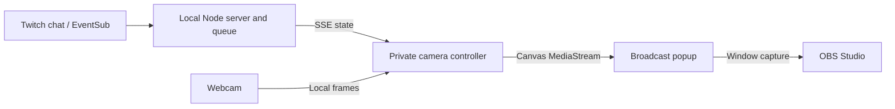

# Chumi: Chat Came Over

Chumi is a purple 3D companion that Twitch viewers can feed through chat. The streamer offers an open palm; Chumi hops onto it, eats a star and returns home. Surprise and cheer commands play separate animations.

[Watch the demo video](https://youtu.be/QaMRDGCyrWg)



The image above is generated concept artwork. [Character preview](documentation/images/character-preview.png) is an actual app screenshot from an earlier UI revision.



## Requirements

- Node.js 22 or newer and npm.
- A desktop browser with WebGL and webcam permission. Keep the controller tab visible.
- A Twitch account and registered Public Twitch application for live chat.
- OBS Studio for recording or broadcasting the output window.

Camera frames and hand detection remain on your computer. The app runs on localhost; no OpenAI API key is required to run it. OpenAI Codex was used during development.

## Install

```sh
git clone https://github.com/dj-DeepakJadhav/chumi.git
cd chumi
npm ci
```

Copy the sample configuration:

Windows PowerShell:

```powershell
Copy-Item .env.example .env
notepad .env
```

macOS or Linux:

```sh
cp .env.example .env
```

Set `TWITCH_CLIENT_ID` to your registered application's client ID and `TWITCH_LOGIN` to your broadcaster login in lowercase. `PORT=3115` selects the local port. Keep `.env` local. The application loads this file automatically; shell environment variables take precedence.

Register your own application in the [Twitch Developer Console](https://dev.twitch.tv/console/apps). Use the Public client type for this app's device authorization flow. Follow [Twitch's registration instructions](https://dev.twitch.tv/docs/authentication/register-app/) for the console's required fields. This app does not use a redirect callback or a client secret. A client ID is a public identifier; access and refresh tokens are credentials.

You can skip Twitch configuration to try local character buttons and the webcam. Live chat requires authorization.

## Authorize Twitch

From the project folder:

```sh
npm run twitch:auth
```

Open the printed Twitch activation link, sign in as the configured broadcaster and approve `user:read:chat`. Wait for the authorization-saved message. Chumi reads chat through EventSub; it does not post replies or moderate the channel. See [Twitch installed-chatbot authentication](https://dev.twitch.tv/docs/chat/authenticating/).

Each machine needs its own authorization. Do not copy `.local` between computers or include it in a recording.

## Start Chumi

In the first terminal:

```sh
npm start
```

Leave it running. In a second terminal, from the same project folder:

```sh
npm run controller
```

This opens the private controller in your default browser. Choose Connect Twitch, then Start camera. If you change a browser permission and it asks for a reload, reload before retrying. Use one active camera controller.

The controller link contains a local authorization token. It is saved under `.local` and removed from the address bar after the app loads. Restarting the server changes it; run `npm run controller` again after a restart. Opening the ordinary localhost URL gives a preview, not a new private controller.

## Play through chat

| Command | Result |
| --- | --- |
| `!snack` | Chumi waits for an open palm, hops over, eats and returns. |
| `!surprise` | Chumi reveals a gift at its home position. |
| `!cheer` | Chumi celebrates. |

Use the exact lowercase commands. Hold an open hand still for about 0.4 seconds to acquire the palm. If your hand leaves, Chumi returns safely. Palm placement and scale are approximate; fingers do not occlude the character.

Each viewer has a three-second cooldown and one outstanding contribution at a time. Five actions can wait behind the active action. Repeated cheers coalesce; a global three-second cheer cooldown also applies. Accepted idle actions start on delivery. A cooldown rejection is not a delayed scheduled command.

Pause interactions cancels current play. Dismiss clears the current action. Quiet mode suppresses playful interactions without replaying cancelled activity when it ends. Reduced motion removes the added hop and balance movement.

The on-screen buttons are local previews. A local button click does not prove Twitch delivery.

## Record with OBS

1. In the camera controller, choose Open broadcast window.
2. In OBS, add Window Capture and select Chumi Broadcast. On macOS, macOS Screen Capture with its window method is another option. Verify the actual preview before recording.
3. Select the output window, not the controller with buttons. Crop browser chrome using Edit Transform, then Fit to screen. Reset output size in Chumi requests a 16:9 window without replacing its stream.
4. Keep the controller visible and the output open. A hidden controller or stopped camera produces standby.
5. Do not add a second webcam source for the same camera. Start a short local recording and inspect playback before recording your demo.

The output is a silent 1280 × 720 composite. Configure microphone audio separately in OBS if needed. The `/broadcast` URL depends on its opener's in-memory stream, so pasting it into an OBS Browser Source will not attach video. Reopening the popup may require reselecting its window in OBS.

## Troubleshooting

- Token refresh failed or subscription revoked: run `npm run twitch:auth`, then reconnect in Chumi.
- Private authorization required: rerun `npm run controller` after a server restart.
- Camera waiting: close other camera sessions, check site and operating-system camera permissions, apply any requested browser reload, then Stop camera and retry. Camera behavior varies by browser and hardware.
- Broadcast is idle: start the camera in the controller that opened this output and keep that controller visible.
- Blank OBS preview: reselect the currently open output window and check screen-recording permission on macOS.
- Port busy: change `PORT` in `.env`, restart the server and reopen the controller.

## Test

```sh
npm test
```

The 35 tests cover interaction completion/cancellation, camera cleanup, tracking math, cooldown boundaries, queue limits, authorization and local HTTP/SSE delivery. They do not replace a real webcam, real Twitch command or OBS recording check.

GitHub provides source download and a test workflow, not a hosted Twitch backend. Run this project locally using the steps above. A public multi-user hosted service would need different authentication and deployment controls.

## Architecture

The interactive architecture diagram was generated with [Archify](https://github.com/tt-a1i/archify) from repository source references. Archify's automated schema, artifact and browser checks passed.



Read the [architecture notes](documentation/ARCHITECTURE.md), or download [the interactive Archify diagram](documentation/architecture.html) and open it locally. GitHub renders the Mermaid overview above; it displays the HTML file as source.

## Documentation

- [Architecture](documentation/ARCHITECTURE.md)
- [Future experiments](documentation/FUTURE.md)
- [Screenshots and demo plan](documentation/MEDIA.md)
- [Security and privacy](SECURITY.md)
- [Third-party materials](THIRD_PARTY.md)
