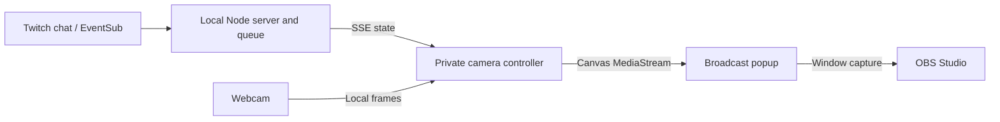

# Architecture

[Open the interactive architecture diagram](architecture.html). Download the HTML and open it locally; GitHub displays its source rather than running it.

The server owns Twitch authorization, queue admission and renderer leases. The browser owns the webcam, MediaPipe hand detection and Three.js animation. The popup receives the silent composite and has no controller buttons or camera ownership.

Controller actions require the local token and matching Origin/Host. Camera readiness and a visible renderer lease are required for live Twitch actions. The server listens only on loopback; it is not a public multi-user service.

The interactive diagram was generated with [Archify](https://github.com/tt-a1i/archify), with repository source references. Its automated schema, artifact and browser checks passed. It is an architecture explanation, not a measured performance diagram.
