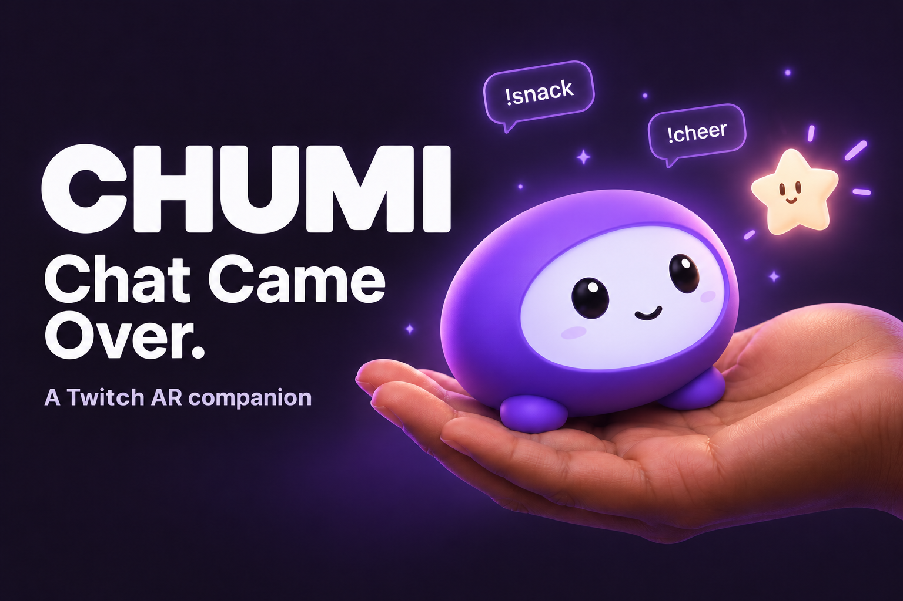

# A shared companion for each channel

Concept artwork above illustrates the palm interaction. It is not an application screenshot.

Chumi gives a viewer and streamer a part in the same action. A viewer sends a snack; the streamer offers their palm. The next versions should build on that exchange during ordinary broadcasts.

## Planned experiments

Channel rituals could give communities their own welcome, celebration and farewell animations. Streamers would choose the available actions and when to allow them.

Community goals could combine contributions from several viewers into one gift reveal. Contributions would have a shared outcome, with limits against repeated input from one account.

Shoulder perching would keep Chumi beside the streamer between palm visits. That needs body tracking and explicit handling for turns and tracking loss. It is not implemented in this version.

For collaborations, participating streamers could approve a gift exchange between communities during a raid or joint stream. This needs additional Twitch permissions and testing before release.

## What to test first

Ask streamers to use Chumi during five minutes of normal content. Record which actions they repeat, when they pause it, and whether they would use it again. These trials should guide new interactions before adding subscriptions, cosmetic packs or paid features. Revenue and retention are not measured yet.
